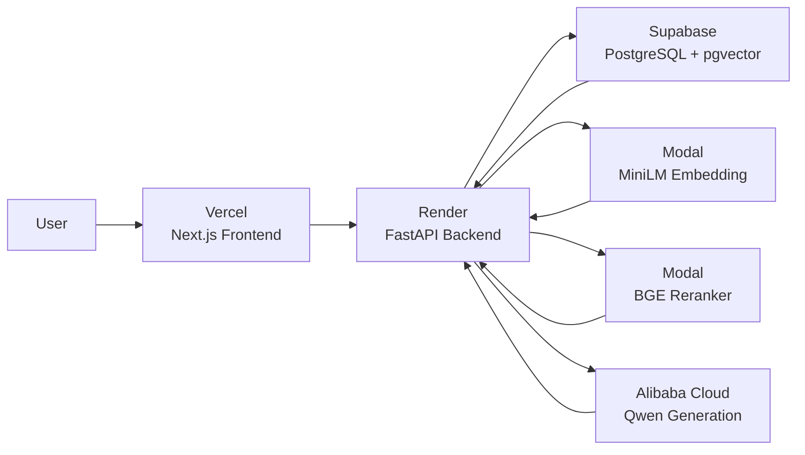
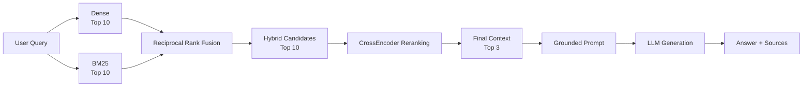

# Study Notes

A production-deployed full-stack technical notes platform with an evaluation-driven Retrieval-Augmented Generation (RAG) system.

The project combines a Next.js frontend, FastAPI backend, PostgreSQL/pgvector storage, hybrid retrieval, CrossEncoder reranking, JWT authentication with role-based access control, evaluation workflows, cloud inference, and RAG safety regression testing.

It started as a personal technical notes application and evolved into a practical RAG engineering project focused on retrieval quality, evaluation, reliability, access control, lifecycle consistency, and production deployment.

---

## Highlights

- Full-stack technical blog with Markdown posts, search, tags, pagination, JWT authentication, and admin-protected CRUD actions
- Authenticated RAG demo for normal users, with evaluation tooling restricted to administrators
- Backend-enforced role-based access control: frontend role state controls UX, while FastAPI validates the authenticated database user before protected operations
- Dense semantic retrieval with `sentence-transformers/paraphrase-multilingual-MiniLM-L12-v2`
- BM25 lexical retrieval for mixed Chinese, English, and technical content
- Hybrid retrieval using Reciprocal Rank Fusion (RRF)
- `BAAI/bge-reranker-v2-m3` CrossEncoder reranking for final context selection
- Automatic RAG index lifecycle: post create/update/delete keeps PostChunk data and the BM25 index synchronized
- Retrieval evaluation with Recall@K and MRR@K on a manually annotated benchmark
- Generation evaluation using an LLM-as-a-judge workflow
- Runtime metadata tracking for traceable experiments
- Source attribution from retrieved blog sections
- Basic RAG safety regression tests covering out-of-scope queries, hallucination pressure, direct and indirect prompt injection, prompt leakage, and malformed input
- Structured logging, latency measurement, and graceful failure handling
- Provider abstraction for local and cloud inference
- Async Modal inference integration for non-blocking remote embedding and reranking calls
- Dockerized backend with bind-mounted source reload for local development and GitHub Actions CI with application-startup smoke testing
- Production deployment with Vercel, Render, Supabase, Modal, and Alibaba Cloud Qwen
- Pytest coverage for retrieval components, RRF fusion, Post/PostChunk lifecycle behavior, and RAG pipeline orchestration

---

## Demo and Access Control

The deployed application separates public content browsing, authenticated RAG usage, and administrator-only management/evaluation features.

```text
Anonymous user
    └── Browse published notes

Authenticated user
    ├── Browse notes
    └── Use the RAG demo

Administrator
    ├── All authenticated-user features
    ├── Create / update / delete posts
    └── Access retrieval, generation, and safety evaluation tools
```

The frontend uses authentication context and route guards to provide the correct UI and navigation flow. Security-sensitive authorization is enforced independently by the FastAPI backend using the JWT identity and the user's database-backed `is_admin` role.

This means modifying client-side role state can change what is displayed in the browser, but cannot grant administrator API permissions.

---

## Production Architecture

The deployed system separates the web application, database, retrieval models, and generation model so that the FastAPI service does not need to host the larger ML models directly.



Production inference:

- Dense embedding: MiniLM served remotely on Modal
- Reranking: BGE reranker served remotely on Modal
- Generation: Qwen served through Alibaba Cloud Model Studio
- Database / vector storage: Supabase PostgreSQL + pgvector
- Backend API: Render
- Frontend: Vercel

Local development keeps the same provider interfaces while using local `sentence-transformers`, CrossEncoder, and Ollama-based Qwen models.

---

## RAG Architecture

The current system uses a two-stage retrieval pipeline:



Dense and lexical retrieval build a high-recall candidate pool. A CrossEncoder reranks those candidates before the final context is sent to the generation model.

Current configuration:

- Dense embedding model: `sentence-transformers/paraphrase-multilingual-MiniLM-L12-v2`
- Hybrid fusion: Reciprocal Rank Fusion
- Reranker: `BAAI/bge-reranker-v2-m3`
- Candidate depth: 10
- Final context depth: 3

### Content and Index Lifecycle

RAG data is kept synchronized with blog content rather than relying on a separate manual ingestion step for normal CRUD operations.

```text
Create / update post
        ↓
Generate or refresh PostChunk records + embeddings
        ↓
Commit database changes
        ↓
Rebuild in-memory BM25 index

Delete post
        ↓
Remove associated persisted data
        ↓
Rebuild BM25 index
```

This keeps dense/vector retrieval and lexical retrieval aligned with the current post content.

---

## Retrieval Evaluation

The retrieval pipeline is evaluated on a manually annotated 10-question benchmark using gold sections as the relevance target.

Current Stage 2 results:

| Stage | Recall | MRR@3 |
|---|---:|---:|
| Dense Retrieval | Recall@10 = 1.00 | 0.733 |
| BM25 Retrieval | Recall@10 = 0.90 | 0.900 |
| RRF Hybrid Retrieval | Recall@10 = 1.00 | 0.833 |
| CrossEncoder Reranking | Recall@3 = 1.00 | 0.933 |

The stages serve different purposes:

```text
Hybrid Recall@10 = 1.00
        ↓
Gold sections reach the candidate pool
        ↓
CrossEncoder reranking
        ↓
Recall@3 = 1.00
MRR@3   = 0.933
```

### Experiment Summary

The initial dense-retrieval baseline achieved an MRR@3 of `0.733`.

BM25 was introduced to improve exact-term and technical-token retrieval. It performed strongly on the benchmark, but lexical retrieval alone still missed some semantically relevant candidates.

The next iteration combined dense and lexical retrieval with Reciprocal Rank Fusion (RRF). The candidate pool was expanded to top 10 so that relevant chunks would have a better chance of reaching the reranking stage.

A representative failure case was the `CORSMiddleware` query:

- Dense retrieval found the gold section at rank 4
- BM25 did not retrieve it within the top 10
- RRF kept it in the hybrid candidate pool at rank 7
- CrossEncoder reranking promoted it to rank 3

The final two-stage pipeline achieved:

- Hybrid Recall@10: `1.00`
- CrossEncoder Recall@3: `1.00`
- CrossEncoder MRR@3: `0.933`

The resulting design intentionally separates candidate coverage from final ranking quality.

---

## Generation and Evaluation

The final retrieved chunks are inserted into a structured grounding prompt and sent through a generation-provider abstraction.

Current model setup:

- Local generation: `qwen3:4b-instruct-2507-q4_K_M` through Ollama
- Local evaluation judge: `qwen3:8b-q4_K_M` through Ollama
- Production generation: Qwen through Alibaba Cloud Model Studio

Generation evaluation uses an LLM-as-a-judge workflow.

Each evaluation run records runtime metadata including:

- code version
- prompt version
- generation and judge configuration
- embedding configuration
- retrieval configuration
- chunking configuration
- reranking configuration

This makes evaluation results traceable to the configuration that produced them.

Evaluation endpoints and UI are restricted to administrators, while normal authenticated users can use the RAG demo without access to internal evaluation tooling.

---

## RAG Safety

A basic safety regression suite tests how the generation layer behaves under adversarial, unsupported, or malformed inputs.

Current test categories include:

- out-of-scope questions
- hallucination pressure when retrieved context is insufficient
- direct prompt injection
- attempts to bypass retrieval grounding
- system-prompt / internal-instruction leakage attempts
- indirect prompt injection through malicious retrieved documents
- malformed or meaningless input

The safety tests reproduced both direct user-input injection and indirect injection through retrieved context. Prompt revisions were regression-tested against the same cases, improving resistance while preserving retrieval grounding.

Indirect-injection testing also exposed a practical trade-off: stronger prompt defenses can cause conservative refusal when adversarial instructions and useful factual content appear in the same retrieved context. The current prompt version favors a balanced mitigation rather than treating the suite as a claim of comprehensive RAG security.

---

## Reliability and Engineering

The project includes production-oriented engineering work beyond the core RAG pipeline:

- structured request and stage logging
- per-stage and total latency measurement
- graceful error handling
- JWT authentication and backend-enforced admin authorization
- route guards for authenticated and administrator-only frontend views
- automatic Post/PostChunk/BM25 lifecycle synchronization
- Dockerized backend with bind-mounted source code and Uvicorn auto-reload for local development
- GitHub Actions CI with PostgreSQL/pgvector-backed tests, Alembic migrations, and FastAPI application-startup smoke testing
- lightweight test inference providers for CI startup validation without external model-service dependencies
- local/cloud provider abstraction using Python `Protocol`
- async Modal RPC calls for production embedding and reranking
- environment-based inference-mode selection
- production dependency slimming with optional local-inference dependencies
- retrieval regression and integration tests

Local inference remains available for development, while production uses hosted model services to keep the Render backend lightweight.

---

## Tech Stack

### Frontend

- Next.js 15
- React 19
- TypeScript
- Tailwind CSS 4
- Remark / GFM

### Backend

- Python
- FastAPI
- SQLAlchemy
- Pydantic
- Alembic
- PostgreSQL / pgvector
- JWT authentication / role-based authorization
- Pytest

### RAG / ML

- sentence-transformers
- BM25
- jieba
- Reciprocal Rank Fusion
- CrossEncoder reranking
- Ollama
- Qwen3
- prompt engineering
- retrieval and generation evaluation
- RAG safety regression testing

### Infrastructure

- Vercel
- Render
- Supabase
- Modal
- Alibaba Cloud Model Studio
- Docker
- GitHub Actions

---

## Project Structure

```text
study_notes/
├── backend/
│   ├── app/
│   │   ├── api/
│   │   ├── core/
│   │   ├── db/
│   │   ├── rag/
│   │   │   ├── evaluation/
│   │   │   ├── ingestion/
│   │   │   ├── pipeline.py
│   │   │   ├── provider_protocols.py
│   │   │   ├── embedding_provider.py
│   │   │   ├── reranking_provider.py
│   │   │   ├── generation_provider.py
│   │   │   ├── test_providers.py
│   │   │   ├── retrieval_dense.py
│   │   │   ├── retrieval_lexical.py
│   │   │   ├── retrieval_hybrid.py
│   │   │   └── reranking.py
│   │   └── schemas/
│   ├── modal_services/
│   └── tests/
│
└── frontend/
    └── src/
        ├── app/
        ├── component/
        ├── context/
        └── evaluation/
```

---

## Current Status

### Completed

- [x] Full-stack technical notes application
- [x] JWT authentication and role-based admin authorization
- [x] Authenticated RAG demo and admin-only evaluation views
- [x] Dense + BM25 retrieval
- [x] Hybrid retrieval with RRF
- [x] CrossEncoder reranking
- [x] Automatic PostChunk refresh and BM25 rebuild on post lifecycle changes
- [x] Retrieval evaluation
- [x] LLM generation
- [x] LLM-as-a-judge evaluation
- [x] Runtime metadata tracking
- [x] Structured logging and latency measurement
- [x] Graceful failure / error handling
- [x] Dockerized backend
- [x] Docker development bind mount and Uvicorn auto-reload
- [x] GitHub Actions CI
- [x] CI application-startup smoke test
- [x] Local / cloud / test inference-provider abstraction
- [x] Modal embedding deployment
- [x] Modal reranker deployment
- [x] Alibaba Cloud Qwen production generation
- [x] Production deployment with Vercel + Render + Supabase + Modal
- [x] Async remote inference integration
- [x] Basic RAG safety regression testing
- [x] Retrieval regression and integration test coverage

### Potential Next Improvements

- [ ] Expanded retrieval, generation, and safety regression datasets
- [ ] Rate limiting / usage controls for public demo traffic if needed
- [ ] Additional production monitoring and deployment hardening

---

## Local Development

Install the backend with local inference dependencies:

```bash
uv sync --extra local-inference
```

Local RAG generation and evaluation use Ollama with the Qwen models listed above.

For Docker-based backend development, the Compose configuration bind-mounts the backend application source into the container and runs Uvicorn with --reload. Python source changes are therefore reflected in the running container without rebuilding the image.

Production uses Modal for embedding and reranking and Alibaba Cloud Model Studio for generation, so the Render backend does not need to host the large ML inference dependencies directly.
