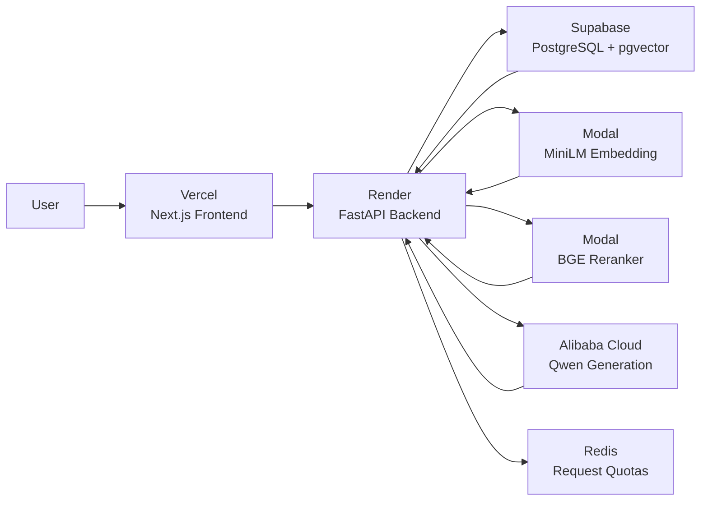
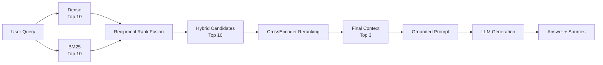

# Study Notes

A production-deployed full-stack technical notes platform with an evaluation-driven Retrieval-Augmented Generation (RAG) system.

**Live Demo:** [Study Notes](https://study-notes-pink.vercel.app/) | **RAG Demo:** [Try the RAG system](https://study-notes-pink.vercel.app/rag)

*Demo note: The first API or RAG request after a period of inactivity may take longer due to backend cold start. Subsequent requests are usually faster.*

The project combines a Next.js frontend, FastAPI backend, PostgreSQL/pgvector storage, hybrid retrieval, CrossEncoder reranking, JWT authentication with role-based access control, evaluation workflows, cloud inference, and RAG safety regression testing.

It started as a personal technical notes application and evolved into a practical RAG engineering project focused on retrieval quality, evaluation, reliability, access control, lifecycle consistency, and production deployment.

---

## Highlights

- Full-stack technical blog with Markdown posts, search, validated tags and pagination, and JWT-protected author/admin management
- Anonymous RAG demo with Redis request quotas; evaluation tooling restricted to administrators
- Backend-enforced role-based access control: frontend role state controls UX, while FastAPI validates the authenticated database user before protected operations
- Dense semantic retrieval with `sentence-transformers/paraphrase-multilingual-MiniLM-L12-v2`
- BM25 lexical retrieval for mixed Chinese, English, and technical content
- Hybrid retrieval using Reciprocal Rank Fusion (RRF)
- `BAAI/bge-reranker-v2-m3` CrossEncoder reranking for final context selection
- PostChunk refresh and in-process BM25 rebuild on post create/update/delete, with tolerance for stale chunk references during retrieval
- Retrieval evaluation with Recall@K and MRR@K on a manually annotated benchmark
- Generation evaluation using an LLM-as-a-judge workflow
- Runtime metadata tracking for traceable experiments
- Source attribution from retrieved blog sections
- Manual RAG safety regression cases covering out-of-scope queries, hallucination pressure, direct and indirect prompt injection, prompt leakage, and malformed input
- Structured logging, latency measurement, and graceful failure handling
- Redis-backed per-IP hourly and global daily admission limits with optimistic concurrency control
- Provider abstraction for local and cloud inference
- Async Modal inference integration for non-blocking remote embedding and reranking calls
- Dockerized backend with bind-mounted source reload for local development and GitHub Actions CI with application-startup smoke testing
- Production deployment with Vercel, Render, Supabase, Modal, and Alibaba Cloud Qwen
- Pytest coverage for retrieval components, RRF fusion, Post/PostChunk lifecycle behavior, and RAG pipeline orchestration

---

## Demo and Access Control

The application separates anonymous browsing/RAG usage, authenticated author workflows, and administrator privileges.

```text
Anonymous user
    ├── Browse published notes and public tags
    └── Use the RAG demo within shared request quotas

Authenticated author (JWT)
    ├── All anonymous-user features
    ├── Create posts and save drafts
    └── View / update / delete their own posts

Administrator
    ├── All author features
    ├── View / update / delete any author's posts
    └── Access retrieval, generation, and safety evaluation tools
```

The frontend uses authentication context and route guards to provide the correct UI and navigation flow. Security-sensitive authorization is enforced independently by the FastAPI backend using the JWT identity and the user's database-backed `is_admin` role.

This means modifying client-side role state can change what is displayed in the browser, but cannot grant administrator API permissions.

Public post queries and tag counts include only published content. Author management endpoints check ownership or administrator status; evaluation and runtime-metadata endpoints require an administrator. Anonymous access applies to `POST /api/v1/rag`, not to the internal evaluation APIs.

---

## Production Architecture

The deployed system separates the web application, database, retrieval models, and generation model so that the FastAPI service does not need to host the larger ML models directly.



Production inference:

- Dense embedding: MiniLM served remotely on Modal
- Reranking: BGE reranker served remotely on Modal
- Generation: Qwen served through Alibaba Cloud Model Studio
- Database / vector storage: Supabase PostgreSQL + pgvector
- Backend API: Render
- Frontend: Vercel
- Request quota storage: Redis, configured through `REDIS_URL`

Local development keeps the same provider interfaces while using local `sentence-transformers`, CrossEncoder, and Ollama-based Qwen models.

Browser API requests use same-origin `/api/*` rewrites from Vercel to the Render backend; Next.js server-side requests use `BACKEND_URL` directly. Modal embedding and reranking are awaited through asynchronous RPCs. The Redis hosting provider is not hard-coded in the repository; live credentials, deployed revisions, and service availability depend on deployment configuration.

Inference modes are explicit: `local` selects local models, `modal` selects Modal embedding/reranking plus cloud Qwen generation, and `test` supplies startup-only providers that reject inference calls. The deployed architecture and the current local working tree may differ until local changes are pushed and deployed.

---

## RAG Architecture

The current system uses a two-stage retrieval pipeline:



Dense and lexical retrieval build a high-recall candidate pool. A CrossEncoder reranks those candidates before the final context is sent to the generation model.

Current configuration:

- Dense embedding model: `sentence-transformers/paraphrase-multilingual-MiniLM-L12-v2`
- Hybrid fusion: Reciprocal Rank Fusion
- Reranker: `BAAI/bge-reranker-v2-m3`
- Candidate depth: 10
- Final context depth: 3
- Markdown-aware chunking: 128-token model budget with an 8-token overlap, using heading paths plus content

Dense retrieval uses pgvector cosine similarity over published posts. BM25 uses jieba tokenization with additional handling for dotted and underscore-separated technical identifiers. RRF merges candidates by post/chunk identity; reranking selects up to three chunks. The response groups source sections under their post titles and links; it provides retrieval attribution rather than independent verification of every generated claim.

### Content and Index Lifecycle

RAG data is kept synchronized with blog content rather than relying on a separate manual ingestion step for normal CRUD operations.

```text
Create / update post
        ↓
Generate or refresh PostChunk records + embeddings
        ↓
Commit database changes
        ↓
Rebuild in-memory BM25 index

Delete post
        ↓
Remove associated persisted data
        ↓
Rebuild BM25 index
```

The lexical retrieval path skips chunk IDs that no longer exist or whose posts are no longer published, then assigns contiguous result ranks. This avoids a missing-chunk failure when a request holds an older BM25 snapshot across a content update or deletion. An empty BM25 corpus is handled as no lexical results.

The BM25 index is held in application memory and rebuilt after the database commit. This is a practical design for a small notes corpus, not an atomic database/index transaction or a distributed index-sync mechanism: rebuild failures can leave a stale index, and separate backend workers do not automatically share refreshed snapshots.

---

## Retrieval Evaluation

The saved retrieval experiment contains 18 cases, of which 10 have manually annotated gold sections and contribute to Recall/MRR. Relevance is determined by exact heading-path matches; cases without gold sections are excluded from these metrics.

Recorded Stage 2 results ([saved experiment](backend/experiments/rrf/rrf_list.json)):

| Stage | Recall | MRR@3 |
|---|---:|---:|
| Dense Retrieval | Recall@10 = 1.00 | 0.733 |
| BM25 Retrieval | Recall@10 = 0.90 | 0.900 |
| RRF Hybrid Retrieval | Recall@10 = 1.00 | 0.833 |
| CrossEncoder Reranking | Recall@3 = 1.00 | 0.933 |

The stages serve different purposes:

```text
Hybrid Recall@10 = 1.00
        ↓
Gold sections reach the candidate pool
        ↓
CrossEncoder reranking
        ↓
Recall@3 = 1.00
MRR@3   = 0.933
```

### Experiment Summary

The initial dense-retrieval baseline achieved an MRR@3 of `0.733`.

BM25 was introduced to improve exact-term and technical-token retrieval. It performed strongly on the benchmark, but lexical retrieval alone still missed some semantically relevant candidates.

The next iteration combined dense and lexical retrieval with Reciprocal Rank Fusion (RRF). The candidate pool was expanded to top 10 so that relevant chunks would have a better chance of reaching the reranking stage.

A representative failure case was the `CORSMiddleware` query:

- Dense retrieval found the gold section at rank 4
- BM25 did not retrieve it within the top 10
- RRF kept it in the hybrid candidate pool at rank 7
- CrossEncoder reranking promoted it to rank 3

The final two-stage pipeline achieved:

- Hybrid Recall@10: `1.00`
- CrossEncoder Recall@3: `1.00`
- CrossEncoder MRR@3: `0.933`

The resulting design intentionally separates candidate coverage from final ranking quality.

These values can be recomputed from the saved ranked results; they are historical experiment results, not a fresh evaluation of the latest deployment. The sample is small and domain-specific, so the numbers do not establish broad retrieval quality. The administrator workflow runs the cases on demand and exports JSON; it is separate from pytest/CI.

---

## Generation and Evaluation

The final retrieved chunks are inserted into a structured grounding prompt and sent through a generation-provider abstraction.

Current model setup:

- Local generation: `qwen3:4b-instruct-2507-q4_K_M` through Ollama
- Local evaluation judge: `qwen3:8b-q4_K_M` through Ollama
- Production generation: Qwen through Alibaba Cloud Model Studio

Generation evaluation uses an LLM-as-a-judge workflow.

The generation-evaluation export fetches runtime metadata including:

- code version
- prompt version
- generation and judge configuration
- embedding configuration
- retrieval configuration
- chunking configuration
- reranking configuration

The current runtime endpoint reports `answer_v5`, uses the configured Qwen model name in cloud mode, and omits the local-only context-window value from cloud generation options (`num_ctx` is null). Generation evaluation judges required/optional answer nuggets or expected refusals; judge-model comparison and human-calibration data are also present. Judge outputs remain model-based assessments rather than ground truth.

The three administrator pages under `/rag`—retrieval evaluation, generation evaluation, and safety testing—are intended primarily for local experiments, avoiding unnecessary paid cloud-token consumption. This is a usage choice, not enforced model isolation: retrieval and safety evaluation call the active RAG providers (and generate answers), while the generation judge is hard-wired to local Ollama. A cloud-configured backend can therefore incur inference costs from these pages, and generation judging requires an accessible Ollama service; it is not a fully hosted evaluation service.

Metadata also has boundaries: the code version is a short Git HEAD hash, requiring Git/repository metadata and not identifying uncommitted changes. The retrieval JSON export still uses a static frontend metadata configuration, whereas generation evaluation fetches runtime metadata. In `test` mode, runtime metadata does not describe the stub providers accurately. Exports should be checked against the actual run configuration before comparing experiments.

---

## RAG Safety

A browser-driven safety workflow provides 12 curated cases for manual regression checks of adversarial, unsupported, or malformed inputs.

Current test categories include:

- out-of-scope questions
- hallucination pressure when retrieved context is insufficient
- direct prompt injection
- attempts to bypass retrieval grounding
- system-prompt / internal-instruction leakage attempts
- indirect prompt injection through malicious retrieved documents
- malformed or meaningless input

The current `answer_v5` prompt treats user queries and retrieved context as untrusted data and asks the model to remain grounded, refuse unsupported answers, and ignore embedded instructions. Multiple prompt versions are retained for comparison. The safety page calls the administrator retrieval-evaluation API and exports retrieval stages and generated answers for inspection; it does not automatically score safety or enforce pass/fail thresholds.

Indirect-injection cases require the corresponding malicious test documents to be present in the evaluation corpus; questions alone do not inject those documents. Input validation also strips query whitespace and enforces a 10–500-character range on the backend.

The engineering trade-off is to resist injected instructions while preserving useful factual content, rather than refusing every mixed context. Prompt-based mitigation and this small manual suite do not guarantee injection resistance, factual correctness, or production-grade security; no current safety pass rate is claimed here.

---

## Redis Request Quotas

The public RAG endpoint checks Redis **before** embedding, reranking, and generation. Defaults are configurable:

| Scope | Default | Window |
|---|---:|---|
| Per application-visible client IP | `RAG_IP_HOURLY_LIMIT=5` | UTC calendar hour |
| All public RAG requests | `RAG_GLOBAL_DAILY_LIMIT=100` | UTC calendar day |

Both counters are checked under Redis `WATCH`, then incremented together using `MULTI/EXEC`. Concurrent modifications trigger a bounded retry with randomized backoff (three attempts by default). Hour/day keys receive 3,600/86,400-second TTLs on first creation for cleanup; the UTC key buckets, not a rolling TTL window, define quota resets.

- **429**: either quota has already been reached.
- **503**: Redis connection/timeout failure, exhausted transaction retries, or unavailable client address. Under contention, requests may be rejected before the quota is fully used.
- A successfully admitted request consumes quota even if later inference fails. These are request counts, not token budgets or a limit on simultaneous model calls.
- The limiter currently applies to the public RAG endpoint, not the administrator evaluation routes or every API. Startup also requires Redis to answer a ping, so a Redis outage during startup can prevent the entire backend from serving.

**Proxy trust limitation:** the per-IP key uses `request.client.host`, whose value can depend on Uvicorn and upstream proxy-header handling. A manual probe showed that a forged `X-Forwarded-For` could alter the Uvicorn access-log IP. The Vercel/Render proxy chain has not been hardened into a verified end-user identity boundary, so per-IP quotas are a best-effort abuse deterrent, not reliable per-person enforcement. Shared proxy addresses can also combine users into one quota. Changing the IP identity does not change the global daily counter, but someone can still exhaust that shared allowance. Redis resets or data loss can reset counters as well; this is a demonstration cost-control measure, not comprehensive abuse prevention.

---

## Reliability and Engineering

The project includes production-oriented engineering work beyond the core RAG pipeline:

- structured request and stage logging
- per-stage and total latency measurement
- graceful error handling
- JWT authentication, author ownership checks, and backend-enforced admin authorization
- route guards for authenticated and administrator-only frontend views
- PostChunk lifecycle maintenance, BM25 rebuilds, and stale-chunk retrieval tolerance
- validated pagination (`offset >= 0`, `1 <= limit <= 100`) and trimmed, non-empty, deduplicated tags of at most 50 characters each
- Dockerized backend with bind-mounted source code and Uvicorn auto-reload for local development
- GitHub Actions CI with PostgreSQL/pgvector and Redis services, Alembic migrations, pytest, and FastAPI application-startup smoke testing
- lightweight test inference providers for CI startup validation without external model-service dependencies
- local/cloud provider abstraction using Python `Protocol`
- async Modal RPC calls for production embedding and reranking
- environment-based inference-mode selection
- production dependency slimming with optional local-inference dependencies
- retrieval regression and integration tests

Local inference remains available for development, while production uses hosted model services to keep the Render backend lightweight.

### Verification Scope

| Evidence | What it covers | Boundary |
|---|---|---|
| Automated pytest tests in `backend/tests` | Technical-token handling, BM25 ranking, RRF, section/chunk generation, database-backed dense/lexical retrieval, PostChunk/BM25 lifecycle behavior, and mocked pipeline orchestration | Does not establish live cloud-model quality or complete HTTP authorization/security coverage |
| GitHub Actions on push | Locked dependency installation, pgvector setup, migrations, pytest, then a bounded `/health` startup check with `INFERENCE_MODE=test` | Test providers deliberately reject inference; no real model calls, frontend build/lint, or deployed-service end-to-end validation |
| Saved/manual experiments | Stage-by-stage retrieval results, generation/judge baselines, and browser-triggered safety inspection | Historical/manual artifacts are separate from automatic regression gates |
| Redis manual probe (`backend/test_rate_limit_manual.py`) | Concurrent requests from 20 synthetic IPs against local Redis DB 15; prints accepted/error totals and the global count | Outside default pytest collection, no assertions, combines 429/503, and uses 10 retries rather than the route's default 3; default quotas are not exceeded by this probe |

Additional manual checks have exercised per-IP and global quota rejection (HTTP 429), key TTL behavior, concurrent counter consistency, and Redis-unavailable responses (HTTP 503), including API-level checks. These checks are not part of the automated pytest/CI suite, and the standalone concurrency script above does not cover all of them. Deployed proxy-IP identity and broader-load behavior remain unverified. The current test suite also lacks dedicated regression cases for every recent validation and stale-chunk fix. A configured CI workflow is not evidence that the latest unpushed working tree has passed remote CI.

---

## Tech Stack

### Frontend

- Next.js 15
- React 19
- TypeScript
- Tailwind CSS 4
- Remark / GFM

### Backend

- Python
- FastAPI
- SQLAlchemy
- Pydantic
- Alembic
- PostgreSQL / pgvector
- Redis (`redis.asyncio`)
- JWT authentication / role-based authorization
- Pytest

### RAG / ML

- sentence-transformers
- BM25
- jieba
- Reciprocal Rank Fusion
- CrossEncoder reranking
- Ollama
- Qwen3
- prompt engineering
- retrieval and generation evaluation
- RAG safety regression testing

### Infrastructure

- Vercel
- Render
- Supabase
- Modal
- Alibaba Cloud Model Studio
- Docker
- GitHub Actions

---

## Project Structure

```text
study_notes/
├── backend/
│   ├── app/
│   │   ├── api/
│   │   ├── core/
│   │   ├── db/
│   │   ├── rag/
│   │   │   ├── evaluation/
│   │   │   ├── ingestion/
│   │   │   ├── pipeline.py
│   │   │   ├── provider_protocols.py
│   │   │   ├── embedding_provider.py
│   │   │   ├── reranking_provider.py
│   │   │   ├── generation_provider.py
│   │   │   ├── test_providers.py
│   │   │   ├── retrieval_dense.py
│   │   │   ├── retrieval_lexical.py
│   │   │   ├── retrieval_hybrid.py
│   │   │   └── reranking.py
│   │   ├── schemas/
│   │   └── services/
│   │       └── rag_rate_limiter.py
│   ├── modal_services/
│   └── tests/
│
└── frontend/
    └── src/
        ├── app/
        ├── component/
        ├── context/
        └── evaluation/
```

---

## Current Status

### Completed

- [x] Full-stack technical notes application
- [x] JWT authentication and role-based admin authorization
- [x] Anonymous RAG demo, JWT author/administrator permissions, and admin-only evaluation views
- [x] Dense + BM25 retrieval
- [x] Hybrid retrieval with RRF
- [x] CrossEncoder reranking
- [x] Automatic PostChunk refresh and BM25 rebuild on post lifecycle changes
- [x] Stale BM25 chunk tolerance, pagination bounds, and tag validation/publication filtering
- [x] Redis per-IP/hour and global/day admission controls with bounded optimistic-concurrency retries
- [x] Retrieval evaluation
- [x] LLM generation
- [x] LLM-as-a-judge evaluation
- [x] Runtime metadata tracking
- [x] Structured logging and latency measurement
- [x] Graceful failure / error handling
- [x] Dockerized backend
- [x] Docker development bind mount and Uvicorn auto-reload
- [x] GitHub Actions CI
- [x] CI application-startup smoke test
- [x] Local / cloud / test inference-provider abstraction
- [x] Modal embedding deployment
- [x] Modal reranker deployment
- [x] Alibaba Cloud Qwen production generation
- [x] Production deployment with Vercel + Render + Supabase + Modal
- [x] Async remote inference integration
- [x] Manual RAG safety regression workflow and curated adversarial cases
- [x] Retrieval regression and integration test coverage

### Potential Next Improvements

- [ ] Expanded retrieval, generation, and safety regression datasets
- [ ] Automated Redis quota/failure/concurrency tests and regression cases for recent validation fixes
- [ ] Additional production monitoring and deployment hardening
- [ ] Consistent runtime metadata across every evaluation export and inference mode

LangChain, LangGraph, and agent workflows are future learning directions. The current project uses a custom Python RAG pipeline and does not implement those frameworks or autonomous agent capabilities.

---

## Local Development

From `backend/`, install the backend with local inference dependencies:

```bash
uv sync --extra local-inference
```

Set the required database, JWT, Qwen, and Redis environment values (see `backend/app/core/config.py`; `.env.example` is only a starting template), run Alembic migrations, and ensure PostgreSQL/pgvector and Redis are available. Select `INFERENCE_MODE=local` for local embedding/reranking; generation and judging then use Ollama with the Qwen models listed above.

For Docker-based backend development, Compose starts the FastAPI server, a PostgreSQL/pgvector test database, and Redis. It bind-mounts the backend application source and runs Uvicorn with `--reload`, so Python source changes are reflected without rebuilding. The checked-in Compose configuration selects `INFERENCE_MODE=modal` and maps Ollama to the host for judging; it is not a fully offline local-model stack. It requires `.env`/`.env.docker`, database initialization/migrations, and cloud credentials. Database/Redis persistence and production orchestration are not provided by this development configuration.

Production uses Modal for embedding and reranking and Alibaba Cloud Model Studio for generation, so the Render backend does not need to host the large ML inference dependencies directly.
